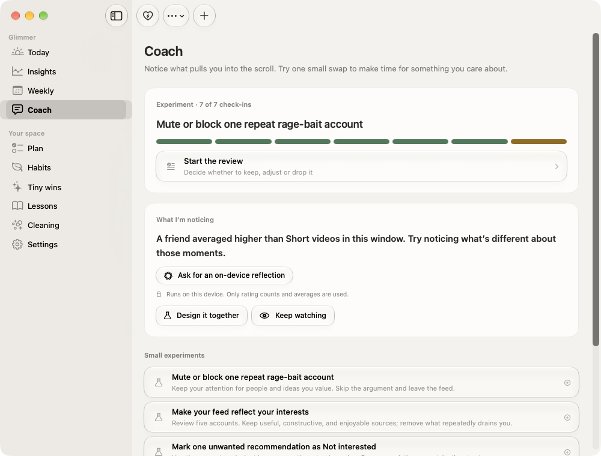
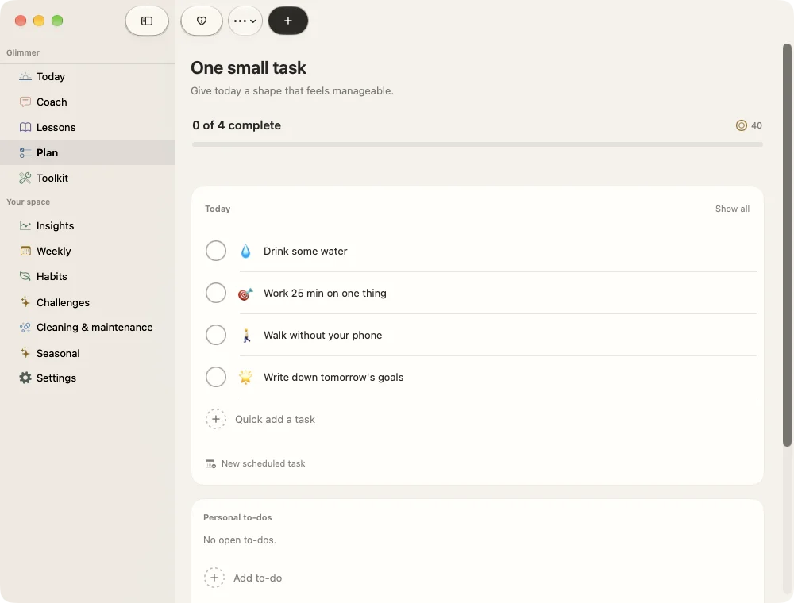
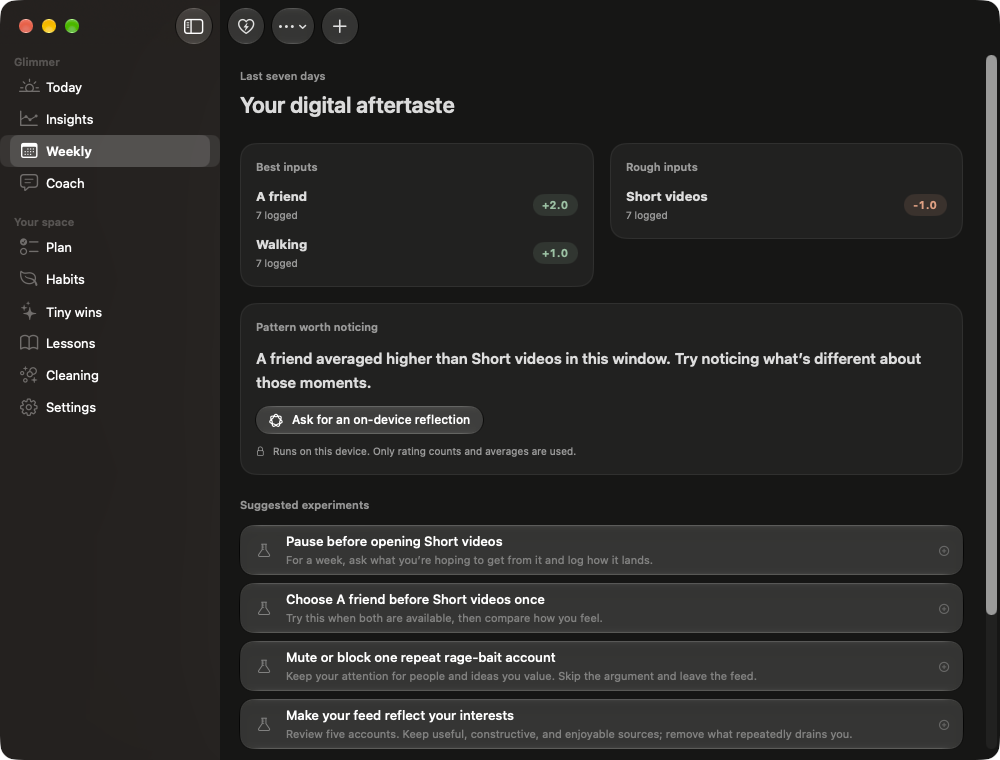
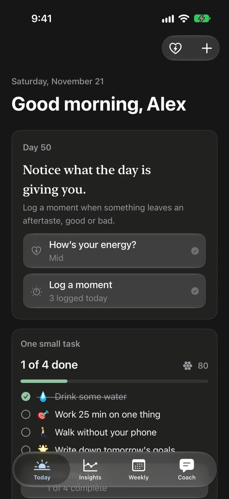
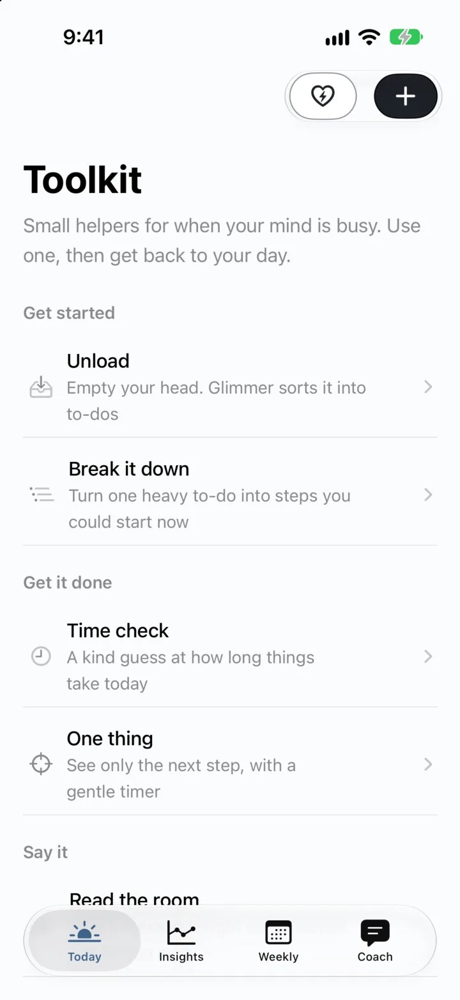
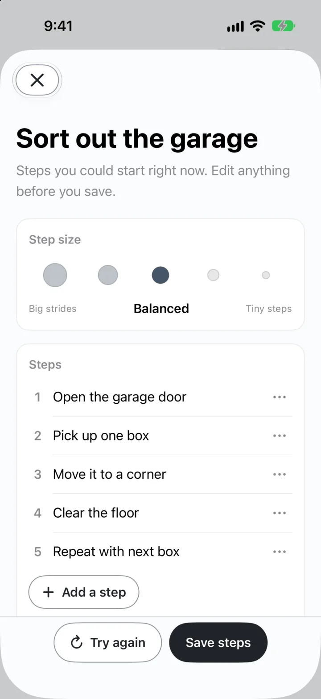

<p align="center">
  
</p>

<h1 align="center">Glimmer</h1>

<p align="center"><strong>A gentle spiritual life coach for minds too busy thinking.</strong><br>Free and private, for deep thinkers, neurodivergent minds, and anyone too busy thinking to keep a tidy to-do list.</p>

<p align="center">
  <a href="https://glimmertoday.com/download"><strong>Download for Mac</strong></a> ·
  <a href="https://glimmertoday.com">glimmertoday.com</a> ·
  <a href="#build-it-yourself">Build it yourself</a> ·
  <a href="LICENSE">public domain (Unlicense)</a>
</p>

<p align="center"><sub>Free · macOS 15 or later · iPhone and iPad coming soon · No account · Open source, public domain (Unlicense)</sub></p>

---



## Check your energy. Pick one small thing. Notice what helps.

Glimmer starts with a ten-second energy check, so a low day gets a smaller plan, and that's the point. Give today one small task, log a moment while you still feel it, and turn the dial to how it left you. Over a week, Glimmer shows you what actually nourishes you and what drains you, then suggests one small experiment to try next.

No streaks to break, no guilt, no account. Your journal stays on your device, works offline, and syncs only through your own private iCloud if you turn it on.

<table>
  <tr><th>Plan your day on Mac</th><th>Review your week</th></tr>
  <tr>
    <td></td>
    <td></td>
  </tr>
</table>

## Tools for a full head

The **Toolkit** takes the mess in your head and hands back one clear next step:

- **Break it down** turns one big task into small steps.
- **Unload** sorts a brain dump into a tidy list.
- **Time check** gives an honest estimate, sized to today's energy.
- **One thing** hides everything else so you can do just this.
- **Read the room** and **Reword** show how a message may land, then soften it.
- **Weigh it** sorts the pros and cons, then suggests a seven-day test.

Each tool runs on your device with Apple Intelligence, or through the agent you connect on Mac (Claude Code, Codex or Gemini CLI). A built-in offline guide works when neither is available.

<table>
  <tr><th>Today</th><th>The Toolkit</th><th>Break it down</th></tr>
  <tr>
    <td align="center"></td>
    <td align="center"></td>
    <td align="center"></td>
  </tr>
</table>

<sub>iPhone and iPad apps are companions to the Mac app and are coming soon. Screenshots use sample entries.</sub>

## More inside

- A 120-lesson reading plan that opens one lesson a day and deepens as you go.
- Habits, mood, guided Tiny Wins with timers, cleaning lists and personal to-dos with reminders.
- Coaching and experiment reviews built from your actual logs, never someone else's average.
- A local MCP connection so your Mac agents can log moments and check off tasks, with access you control.
- JSON backup and restore from Settings.

## Build it yourself

Use a Mac with Xcode 26 or later.

```sh
git clone https://github.com/protomota/glimmer.git
cd glimmer/native
open Glimmer.xcodeproj
```

Choose the **Glimmer** scheme and run it on My Mac, an iPhone or an iPad simulator. Local builds work without iCloud. For sync on real devices, use your own Apple Developer team, bundle identifier and iCloud container. The full build, sync and agent guide is in [native/README.md](native/README.md).

| Path | What's there |
| --- | --- |
| `native/Glimmer` | The SwiftUI app for Mac, iPhone and iPad |
| `native/Checks`, `native/GlimmerUITests` | Core checks and UI tests |
| `brand/` | The app icon sources and render script |

## Open source, public domain (Unlicense)

Glimmer is free, and its source is open under the [public domain (Unlicense)](LICENSE). Use it, change it, ship it, sell it. Third-party packages keep their own licenses.

[Website](https://glimmertoday.com) · [Help](https://glimmertoday.com/support) · [Send feedback](https://protomota.com/apps?app=glimmer#feedback)

---

<p align="center">
  <a href="https://protomota.com"></a>
</p>

<p align="center"><strong>Made by <a href="https://protomota.com">Protomota</a>.</strong> Free apps, open source and public domain (Unlicense).</p>

<p align="center">
  <a href="https://opentalon.ai">OpenTalon</a> ·
  <a href="https://inkspring.ai">Inkspring</a> ·
  <a href="https://jotley.ai">Jotley</a> ·
  <a href="https://glimmertoday.com">Glimmer</a> ·
  <a href="https://pulsecanvas.ai">PulseCanvas</a> ·
  <a href="https://voxley.si">Voxley</a> ·
  <a href="https://textley.ai">Textley</a> ·
  <a href="https://graphley.ai">Graphley</a> ·
  <a href="https://bucksley.ai">Bucksley</a>
</p>

<p align="center"><a href="https://lab.protomota.com">Join the Lab</a> · <a href="https://newsletter.protomota.com">Newsletter</a> · <a href="https://protomota.com/open-source">Open source at Protomota</a></p>
